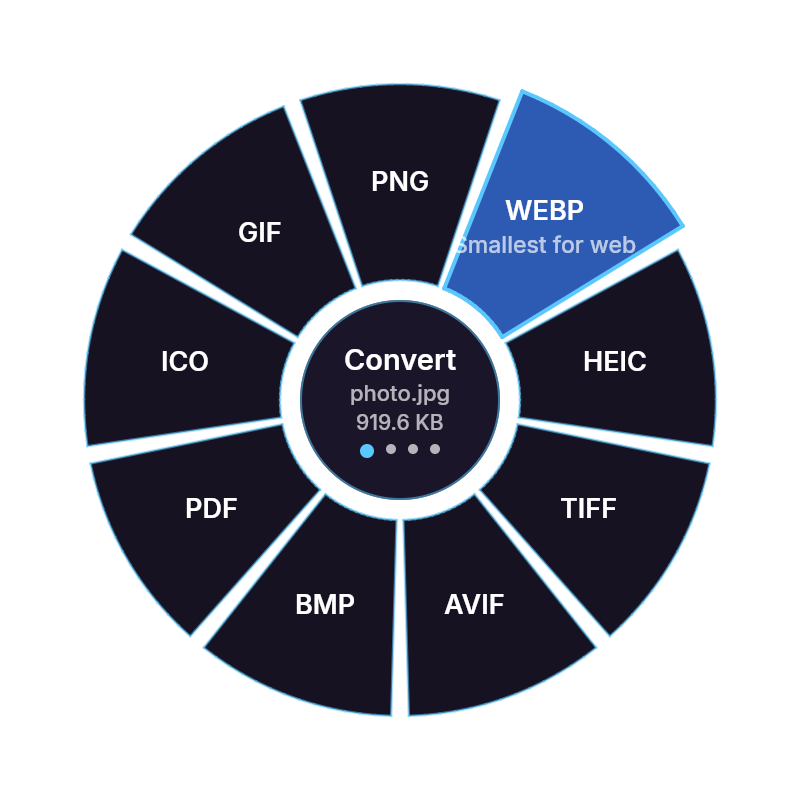
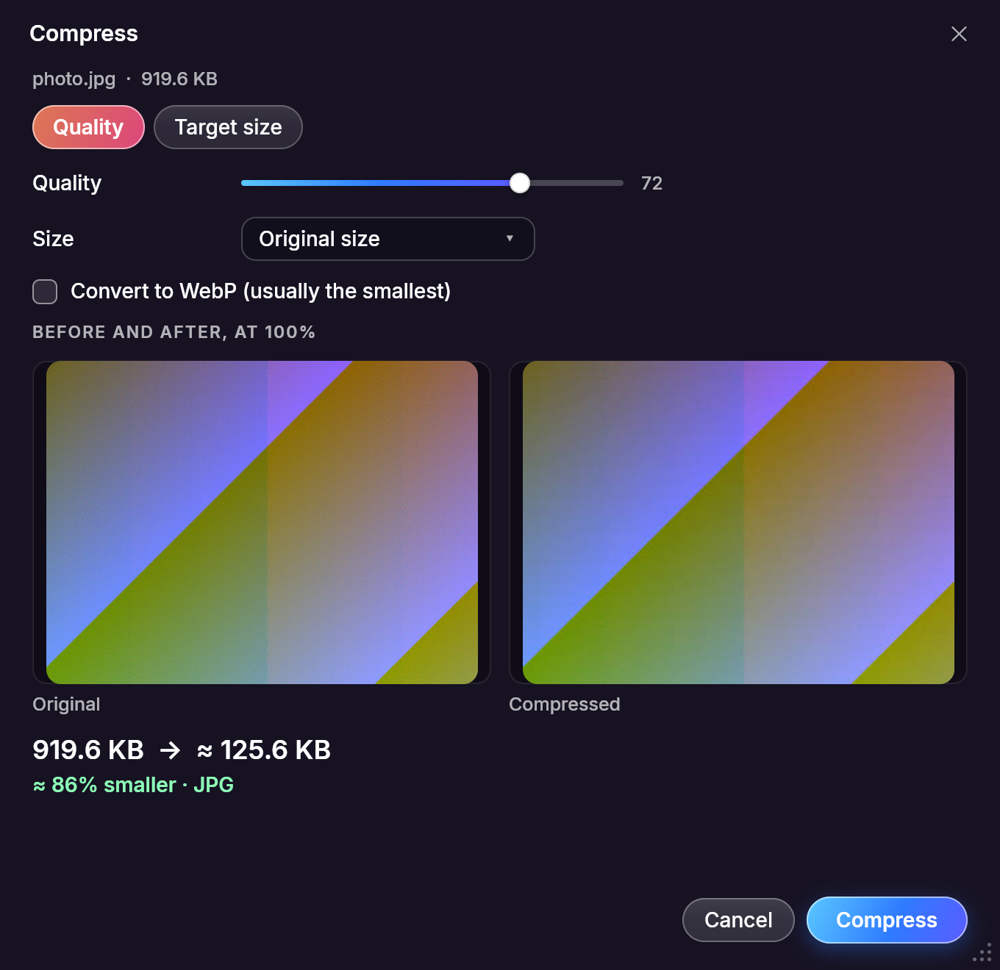

# Utsuri

Drag a file and tap **Shift** to get a radial menu of actions for it: convert images and
documents, compress, resize, crop, redact, annotate, PDF tools (split, merge, protect, unlock,
organize pages, OCR), video and audio conversions, archives, and more. Drop the file on a slice
and it's done, with Open / Show in folder / Undo.

Written in Rust on the [Rune](https://github.com/anomalyco/rune) UI toolkit. Runs on
**Windows 10/11 (x64)** and **Linux (Wayland, Hyprland)**.

| Radial menu | Tool window |
|---|---|
|  |  |

The Python version of Utsuri is kept in this repo's history: tag `python-final`.

## Install on Windows

Build the installer from source (there are no prebuilt downloads yet):

1. Install [Rust](https://rustup.rs) and the
   [Visual Studio Build Tools](https://visualstudio.microsoft.com/visual-cpp-build-tools/) with
   the "Desktop development with C++" workload. `rust-toolchain.toml` picks the Rust version.
2. Build (takes a while the first time):
   ```bash
   cargo build --release -p utsuri
   cargo build --release -p setup
   ```
3. Run `target\release\utsuri-setup.exe`. It installs per user (no admin), adds a Start menu
   entry, starts with Windows, and can be removed from Settings > Apps.

Optional, for video/audio and OCR: `winget install Gyan.FFmpeg` and
`winget install UB-Mannheim.TesseractOCR`.

## Install on Linux

1. Tools (Arch): `sudo pacman -S --needed rust poppler libheif` and, optionally,
   `ffmpeg tesseract tesseract-data-eng`.
2. The trigger reads the keyboard and mouse buttons directly, so your user needs the `input`
   group: `sudo usermod -aG input $USER`, then sign out and back in.
3. Build and install to `~/.local` (no root): `packaging/linux/install.sh`
   (`--autostart` to start it at login). Remove with `packaging/linux/uninstall.sh`.

Linux notes: the pointer position and window placement use Hyprland's IPC, so other Wayland
desktops are untested. Right-click "Utsuri…" is added to Dolphin and to "Open with".

## Privacy

No accounts, telemetry or update checks. Files are processed locally; originals are never
modified (results are written next to them, and Undo moves a result to the trash).

## Development

```bash
cargo test --workspace
cargo run -p utsuri
```

- `cargo build --profile fast`: an optimized build in about half the time of `--release`; set
  `CRATUS_PROFILE=fast` to point the test scripts at it.
- Headless UI tests (no screen, mouse or keyboard): `tests\utsuri_headless.ps1` on Windows,
  `python3 tests/linux/headless.py` on Linux.
- Real-screen tests (they move the mouse and type; leave the PC alone meanwhile):
  `cargo run -p utsuri-e2e` (both platforms), `tests\install_test.ps1` (Windows).
- Design notes, Rune patches and lessons learned: [docs/NOTES.md](docs/NOTES.md).

`vendor/rune` is Rune at rev `c369cc0` with a few patches (search for "cratus-rs"), and
`vendor/winit` is Rune's winit with one fix. Their licenses are in those folders.

## License

[MIT](LICENSE).
